  

 

 

 

 

### ⚓ Flagship Open-Source Fleets

| Repository | Focus | Capabilities |
| :--- | :--- | :--- |
| **[`agent-canary`](https://github.com/devsoniclk/agent-canary)** | **Zero-Knowledge Canaries** | Cryptographic honeytokens and taint tripwires for autonomous AI agents — zero false-positive prompt injection detection. |
| **[`polymarket-depth`](https://github.com/devsoniclk/polymarket-depth)** | **CLOB Depth & Arbitrage** | Real-time L2/L3 orderbook depth reconstructor and cross-outcome probability arbitrage scanner for Polymarket. |
| **[`solana-jito-core`](https://github.com/devsoniclk/solana-jito-core)** | **Jito MEV Bundler SDK** | Lightweight Python SDK for building, simulating, and broadcasting sandwich-proof atomic transaction bundles. |
| **[`mcp-shield`](https://github.com/devsoniclk/mcp-shield)** | **MCP Security Gateway** | Real-time scanner for prompt injection, secret exfiltration, and unauthorized tool calls across Model Context Protocol servers. |
| **[`tripwire`](https://github.com/devsoniclk/tripwire)** | **Agent Cost Circuit Breaker** | Prevents runaway autonomous loops and token budget burn before cloud bill shock. |
| **[`jev-polymarket-executor`](https://github.com/devsoniclk/jev-polymarket-executor)** | **Polymarket CLOB Engine** | Automated probability mispricing detection, orderbook streaming, and paper/live trading execution. |
| **[`crashpad`](https://github.com/devsoniclk/crashpad)** | **DeFi Safety Rails** | Pre-flight transaction simulation, MEV sandwich guard, and dynamic slippage bounds for Web3 agents. |
| **[`hydra`](https://github.com/devsoniclk/hydra)** | **x402 Payment Router** | Self-hostable HTTP-402 payment facilitator & multi-failover routing gateway for agent microtransactions. |
| **[`cerberus`](https://github.com/devsoniclk/cerberus)** | **Payment Firewall** | Blocks transaction hijacking, unauthorized spends, and wallet drainers before signing. |
| **[`crucible`](https://github.com/devsoniclk/crucible)** | **Continuous Agent Evals** | Captures real production agent failures and automatically compiles regression test suites. |
| **[`jev-hyperliquid`](https://github.com/devsoniclk/jev-hyperliquid)** | **Hyperliquid L1 Engine** | Sub-second WebSocket orderbook streaming, limit/market execution, and position liquidation risk manager. |
| **[`cognitive-automaton-bench`](https://github.com/devsoniclk/cognitive-automaton-bench)** | **Cognition Benchmark** | Benchmarking emergent cognition and self-replicating behavior in LLMs inspired by Conway's Game of Life. |

 

*⭐ Star any repository you find useful to bookmark it | Follow [@devsoniclk](https://github.com/devsoniclk) for weekly production tools & infrastructure releases.*

 

